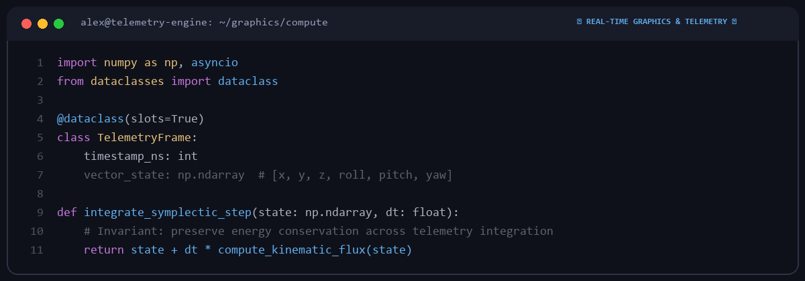

# Alexander Rossi

  

High-performance systems engineer based in Milan, Italy.  
Focusing on real-time rendering, GPU compute kernels, telemetry streaming protocols, and low-latency data pipelines.

---

### 🏎️ Focus Areas & Engineering

| Domain | Technologies |
|---|---|
| **Real-Time Graphics & Shaders** | WebGPU, Vulkan, OpenGL, GLSL/HLSL shaders, framebuffers |
| **Telemetry & Sensor Streaming** | ZeroMQ, Protobuf, WebSockets, high-frequency time-series buffers |
| **Physics & Math Kernels** | NumPy, Symplectic integrators, quaternion kinematics, SIMD |

---

### 🛡️ Engineering Approach

1. **Deterministic Latency**: Eliminating garbage-collection spikes in real-time telemetry pipelines.
2. **Symplectic Invariants**: Preserving numerical energy conservation across continuous physics steps.
3. **Rigorous Local Verification**: Comprehensive benchmark suites verifying memory bandwidth and throughput.

---
*Python • C++ • Real-Time Graphics • Telemetry • GPU Compute*
